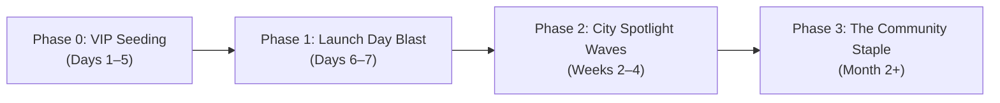
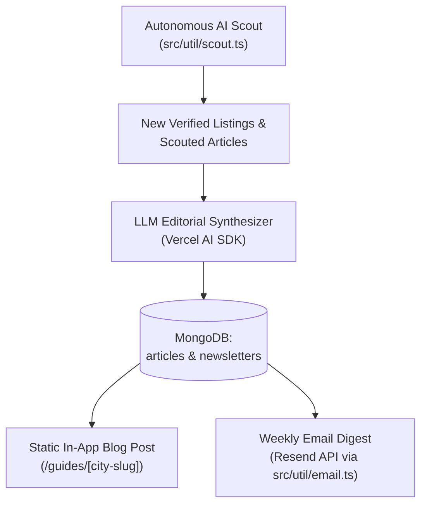

# The MOBB v3.0 Launch & Marketing Rollout Plan
*Positioning The MOBB as the Indispensable Staple for Black Travelers & Conscious Consumers*

---

## 1. Executive Summary & Brand Positioning

### The Mission & Vision
**The Map of Black Businesses (MOBB)** is digital infrastructure for economic equity, built to serve the diaspora and empower group economics. Our mission is to make finding, patronizing, and supporting Black-owned businesses frictionless—whether stepping off a flight across the country or shopping from home.

### The Core Brand Positioning: "The Modern Green Book"
For decades, travelers relied on word-of-mouth or fragmented social media lists to find welcoming, culturally grounded spaces when away from home. The MOBB v3.0 reimagines this need for the modern digital era:
- **Instant Geospatial Discovery:** One tap locates nearby coffee shops, restaurants, bookstores, barbers, boutiques, and wellness spots.
- **National Reach & Local Roots:** Bridges local neighborhood discoveries with a nationwide directory and online-only e-commerce brands.
- **Autonomous & Community-Powered:** Driven by AI-assisted web scouting and community-submitted updates to keep listings verified and fresh.

### Brand Taglines & Micro-Copy
- **Primary Slogan:** *"Give your dollar the choice to make a difference... Just MOBB It."*
- **Traveler Hook:** *"Land in any city. Find your people. Support the culture."*
- **Conscious Consumer Hook:** *"Turn your spending power into community equity."*
- **Brand Identity:** Warm, inviting, modern, and communal. High-contrast dark mode with signature safety-orange accents (`#FF5A00`).

---

## 2. Target Audiences & Use Cases

| Persona | Motivation | Primary App View | Key Pain Point Solved |
| :--- | :--- | :--- | :--- |
| **The Frequent Traveler & Nomad** | Conferences, vacations, business trips; wants authentic local Black food, nightlife, and services. | **Local Map** (`?view=map`) | Ending up at generic airport chains because they didn't know what was two blocks away. |
| **The Conscious Everyday Consumer** | Intentional spending, practicing group economics in their own city or region. | **Directory** (`?view=directory`) | Fragmentation across Yelp, Instagram tags, and outdated 2020 PDF lists. |
| **The Diaspora Shopper** | Wants to buy Black-owned beauty, apparel, books, and specialty goods online. | **Online Only** (`?view=online`) | Discovering verified Black-owned online brands with direct links to storefronts. |
| **The Black Business Owner** | Wants foot traffic, visibility, and direct customer discovery without paying pay-to-play ad fees. | **Add a Business** drawer | Being drowned out by big-budget corporate chains on mainstream discovery platforms. |
| **The Tech & Open-Source Community** | Engineers, designers, and creators who care about ethical tech, modern Next.js/React architecture, and civic tech. | **Tech Stack** (`/tech-stack`) | Seeing how modern engineering (Next.js 16, MongoDB 2dsphere, AI curation) solves community problems. |
| **Third-Party Builders & Civic Tech** | Developers, event planners, and travel tech founders wanting to embed Black-owned business data into their applications. | **Developer API** (Roadmap) | Lack of structured, verified geospatial APIs for minority-owned business discovery. |

---

## 3. Four-Phase Rollout Strategy



### Phase 0: VIP Seeding & Community Insiders (Days 1–5)
- **Objective:** Warm up key voices, test live traffic, and seed community-submitted listings in top 10 travel hubs.
- **Key Actions:**
  - Direct message 50 Black travel influencers, foodies, and community organizers (Atlanta, DC, Houston, Chicago, NYC, LA, New Orleans, Charlotte, Detroit, Philadelphia).
  - Provide a preview link: *"We're launching the next evolution of The MOBB next week—take a look and make sure your favorite hometown spots are on the map."*
  - Collect initial feedback on mobile UX, address accuracy, and category tagging.

### Phase 1: Launch Day Drop (Days 6–7)
- **Objective:** Maximum organic reach and coordinated social buzz across all platforms simultaneously.
- **Coordinated Drops:**
  1. Founder announcement on **LinkedIn** (Focus: Economic equity, tech architecture, group economics).
  2. Visual carousel & Reel on **Instagram** (Focus: "The Modern Green Book in your pocket").
  3. Discussion threads on **Reddit** (Targeted cultural, travel, and builder communities).
  4. Community announcements in high-traffic **Facebook Groups** (Black travelers, digital nomads, local chambers).
  5. Deep-dive technical post on **Dev.to / Hashnode** (Focus: Next.js 14+ App Router, geospatial queries, AI agent curation).
  6. Launch campaign hashtag: **`#JustMOBBIt`** and **`#TheMOBB`**.

### Phase 2: Geographic Waves & "City Spotlight" Series (Weeks 2–4)
- **Objective:** Establish The MOBB as the default travel companion city-by-city.
- **Weekly City Guides:**
  - **Week 2:** Atlanta & Washington D.C. (Top hubs for Black travel & culture).
  - **Week 3:** Houston & New Orleans (Culinary & cultural powerhouses).
  - **Week 4:** Chicago & New York / Brooklyn (Urban centers & retail hubs).
- **Execution:** Post curated 24-hour itineraries ("Where to eat, drink, read, and shop in 24 hours using The MOBB").

### Phase 3: Becoming "The Staple" & Long-Term Retention (Month 2+)
- **Strategic Travel Partnerships:**
  - Pitch partnerships and co-marketing with organizations like **Nomadness Travel Tribe**, **Black Travel Alliance**, **Black Girls Travel Too**, and **HBCU Alumni Associations**.
  - Event integrations: ESSENCE Festival (New Orleans), Afrotech (Houston/Austin), Black Tech Week, Juneteenth celebrations, and HBCU Homecomings.
- **Physical "Found on The MOBB" Merchant Badges:**
  - Send physical holographic window stickers and QR code counter-top cards to the top 200 physical locations: *"Proudly Listed on The MOBB. Scan to check in & find more Black-owned spots nearby."*

---

## 4. Multi-Channel Content Kit (Ready to Publish)

### A. Instagram Content Suite

#### Post 1: Multi-Slide Carousel (The Launch Drop)
- **Visual Design:** Dark theme aesthetic (`#070709`), bold neon amber accents (`#FF5A00`), crisp mobile UI screenshots.

```
[Slide 1 - Cover Image]
Bold headline over app screenshot:
"The Green Book just got an upgrade for 2026."
Subtitle: Meet The MOBB — Map of Black Businesses.

[Slide 2]
Visual: Split screen of phone in airport / downtown street + MOBB Local Map view.
Text:
"You just landed in a new city.
Where's the nearest Black-owned coffee spot?
The bookstore? The soul food? The wellness club?
Stop scrolling through 4-year-old viral tweets. Tap 'Near Me' and go."

[Slide 3]
Visual: Screenshot of Directory View with category filter badges.
Text:
"3 Ways to MOBB:
1. Local Map: Real-time proximity discovery for when you're on the move.
2. The Directory: Searchable catalog across 25+ categories nationwide.
3. Online & Everywhere: Support Black-owned e-commerce brands right from home."

[Slide 4]
Visual: Screenshot of "Suggest an Edit" & "Add a Business" interface.
Text:
"Powered by the Diaspora.
Know an incredible spot that belongs on the map?
Submit it in 30 seconds. Help our community directory stay alive, accurate, and independent."

[Slide 5 - CTA]
Visual: Clean graphic with URL and QR code.
Text:
"Give your dollar the choice to make a difference.
Tap the link in bio to try it now — no app store download required.
Save this post for your next trip."
```

**Caption:**
```markdown
When you travel, where does your dollar go? 📍

For decades, our community used the Green Book to navigate, connect, and support each other on the road. Today, we're taking that legacy into the modern era.

Introducing The MOBB v3.0 (Map of Black Businesses) — high-speed digital infrastructure built for economic equity and group economics.

Whether you're touching down in Atlanta for the weekend, looking for a Black-owned barber in Chicago, or ordering specialty tea online from your couch, The MOBB puts hundreds of verified businesses in your hands in milliseconds.

🔗 Explore now at mobb.kielbyrne.com (link in bio)
✨ Free to use. Mobile-ready. No app store download needed.
🏷️ Tag your favorite Black-owned spot in the comments so we can make sure they’re on the map!

#TheMOBB #JustMOBBIt #BuyBlack #BlackOwned #BlackTravelers #GroupEconomics #SupportBlackBusiness #BlackNomad
```

#### Post 2: Traveler POV Reel / Video Script (30 Seconds)
- **Setting:** Person with a carry-on bag walking through an airport or city street, looking at phone.
- **Audio:** Chill lofi beat with punchy voiceover.
- **Script:**
  - *[0:00 - 0:05]* "Tell me if this sounds familiar: you land in a city for a conference or vacation, and you end up at the same generic chain cafe because you didn't know what was around the corner."
  - *[0:05 - 0:15]* *(Screen recording showing browser opening mobb.kielbyrne.com -> tapping "Local Map" -> pulsing nearest listings within 0.8 miles)* "Open mobb.kielbyrne.com. Tap Local Map. Boom: 4 Black-owned breakfast spots, a local coffee roaster, and a bookstore 8 minutes away."
  - *[0:15 - 0:25]* "No ads, no pay-to-play algorithm. Just clean, fast discovery designed to keep our dollars circulating in the community."
  - *[0:25 - 0:30]* "Bookmark it on your home screen before your next flight. Just MOBB it."

---

### B. Facebook Community Posts

#### Post 1: For Black Travel & Digital Nomad Groups
*(Nomadness Travel Tribe, Black Travelers International, Black Girls Travel Too, Black Men Travel)*

```markdown
Peace everyone! ✈️🌍

Question for the frequent travelers and nomads here: how do you usually find Black-owned businesses when you land in a new city? 

Like many of you, I was tired of bookmarking chaotic Twitter threads, outdated blog roundups from 2020 where half the spots closed, or manually cross-referencing Google Maps while rushing between meetings.

To solve this, we just rolled out v3.0 of The MOBB (Map of Black Businesses) at https://mobb.kielbyrne.com

Here’s why it’s built specifically for how we travel:
📍 Instant "Near Me" Map: Open it up on your phone anywhere in the country, and it automatically highlights verified Black-owned restaurants, cafes, boutiques, bookstores, and services closest to your exact location.
🧭 The Directory: Search across 25+ categories in major hubs across the US.
💻 Online & Everywhere: A dedicated view for Black-owned e-commerce brands you can support from anywhere.
⚡ Zero Friction: Runs lightning-fast right in your mobile browser (Progressive Web App—no app store download required).
🤝 Community Driven: If your favorite local gem isn't listed yet, you can add it directly or suggest an edit in 30 seconds.

Our dollars have massive collective power when we make conscious choices on the road. Give it a spin on your next trip and let me know what you think:
👉 https://mobb.kielbyrne.com

What’s the #1 Black-owned spot in your hometown that everyone visiting MUST experience? Drop it below! 👇
```

#### Post 2: For Local Business & Chamber of Commerce Groups

```markdown
Calling all Black founders, restaurateurs, and service providers! 📢

Visibility shouldn't require paying thousands in ad spend to big tech platforms that suppress organic discovery.

We’ve built The MOBB (https://mobb.kielbyrne.com) to provide clean, free digital infrastructure that connects conscious consumers and travelers directly with Black-owned brick-and-mortar stores and online businesses.

If you own or manage a business:
1. Visit https://mobb.kielbyrne.com
2. Search for your business to see if you're already verified on the map.
3. If not, tap "Add a Business" to get listed for free.
4. If your hours, address, or details need updating, tap "Suggest an Edit" to ensure travelers can reach you easily.

Let's strengthen our local economic ecosystems together. Share this with fellow business owners!
```

---

### C. LinkedIn Thought Leadership & Founder Launch Post

#### LinkedIn Founder Launch Post
```markdown
Economic equity requires infrastructure, not just good intentions.

Over the last few decades, we’ve seen countless viral campaigns encouraging consumers to "Buy Black." Yet, when someone lands in an unfamiliar city for a business trip, the friction of finding a Black-owned coffee shop or dinner spot within walking distance often leads them straight back to national corporate chains.

Convenience usually beats intent. If we want group economics to thrive, we have to make supporting our community just as fast and seamless as hailing an Uber or ordering on DoorDash.

That is why we built The MOBB (Map of Black Businesses) — and today, we are releasing version 3.0: https://mobb.kielbyrne.com

What we built:
• Instant Geospatial Engine: High-performance MongoDB 2dsphere indexing and Google Maps integration showing nearby businesses in real-time.
• Three Dedicated Experiences:
  1. Local Map: Proximity-first radar for travelers and on-the-go locals.
  2. Directory: Deep-categorized nationwide directory with instant filtering.
  3. Online & Everywhere: Curated index of diaspora e-commerce businesses.
• Autonomous AI Scout & Community Curation: An intelligent data ingestion pipeline that constantly surfaces emerging businesses while empowering community members to report updates.
• Modern Architecture: Engineered with Next.js 16, React 19, Panda CSS for zero-runtime styling overhead, and strict TypeScript/Zod validation.
• Developer API (Coming Soon): We are building a public API with tiered access so third-party travel apps, civic tech creators, and community builders can tap into our verified business data and embed it in their own platforms.

Our goal is simple: make The MOBB an indispensable daily staple for travelers, entrepreneurs, and conscious consumers practicing group economics across the diaspora.

Take a look, bookmark it for your next trip, and share your feedback:
🔗 https://mobb.kielbyrne.com

#Technology #SocialImpact #NextJS #GroupEconomics #BlackOwnedBusiness #CivicTech #WebDevelopment #Entrepreneurship
```

#### LinkedIn Full Article Draft
**Title:** *Why Economic Equity Needs Infrastructure, Not Just Hashtags: Building The MOBB v3.0*
*(Summary of key sections for publication via LinkedIn Articles)*
1. **The Intent-to-Action Gap:** The trillion-dollar spending power of the Black diaspora and why friction kills conscious consumerism.
2. **The Modern Green Book Concept:** Historical precedent of Victor Hugo Green’s guide and why software engineering must step up to solve this today.
3. **Engineering for Trust & Speed:** Why directories fail (stale data, slow UI, bad search) and how v3.0 tackles this with server actions, real-time geospatial queries, and AI scanning.
4. **The Road Ahead:** Empowering local merchants, building travel community partnerships, scaling the autonomous curator, and opening a public developer API to democratize access to diaspora business data.

---

### D. Reddit Community Strategy (Tailored by Subreddit)

#### Post 1: Cultural & Community Subreddits
*Subreddits: r/blackladies, r/blackfathers, r/AfricanAmerican*
- **Title:** *I built a free tool to help us easily find and support Black-owned businesses when traveling (The MOBB v3.0)*
- **Body:**
```markdown
Hey everyone,

Whenever I travel for work or vacation, one of my top priorities is finding local Black-owned restaurants, cafes, bookstores, and services. But I found myself constantly frustrated by having to dig through old 2021 Instagram carousels or Yelp reviews with outdated hours.

I spent the last several months building and upgrading **The MOBB (Map of Black Businesses)** — a free web app designed to make finding Black-owned spots anywhere in the country effortless:

👉 https://mobb.kielbyrne.com

What it does:
- **Local Map:** Automatically shows what's closest to you with one tap. Perfect when you're walking around an unfamiliar neighborhood or downtown area.
- **Directory:** Searchable by 25+ categories (Coffee, Dining, Books, Health, Retail, Nightlife, etc.).
- **Online Only:** For when you want to support Black-owned brands from home.
- **Community Driven:** Anyone can submit a new business in 30 seconds or suggest updates so the info stays fresh.

It's completely free, no ads, and works right in your phone's browser without needing to download anything from the app store.

I'd love for you all to test it out in your city and let me know what you think. If your favorite spot is missing, please add it!

Hope this helps some of you on your upcoming trips!
```

#### Post 2: Travel & Digital Nomad Subreddits
*Subreddits: r/travel, r/solotravel, r/digitalnomad*
- **Title:** *Built a lightweight, responsive map tool for locating local minority-owned businesses when traveling in the US*
- **Body:** Focuses on the utility of discovering authentic, non-chain, community-rooted neighborhood spots, coffee shops, and independent bookstores across major US cities. Emphasizes clean UI, fast load times, and no paywalled recommendations.

#### Post 3: Developer & Builder Subreddits
*Subreddits: r/SideProject, r/nextjs, r/webdev*
- **Title:** *Show r/SideProject: The MOBB v3.0 – Geospatial directory built with Next.js 16, MongoDB $near, Panda CSS, and AI curation*
- **Body:**
```markdown
Hey r/nextjs / r/SideProject,

I wanted to share a major rewrite of a project I've been maintaining: **The MOBB (Map of Black Businesses)** at https://mobb.kielbyrne.com.

The premise: Create a high-performance modern web app allowing users to find Black-owned businesses in their immediate vicinity or nationwide.

Tech Stack & Architecture Highlights:
- **Framework:** Next.js 16 (App Router) + React 19
- **Geospatial Queries:** MongoDB Atlas 2dsphere indexing with `$near` and `$geoWithin` operators executed via Server Actions.
- **Styling:** Panda CSS (zero-runtime CSS-in-JS that compiles at build time for blistering performance).
- **Mapping:** @vis.gl/react-google-maps with custom marker clustering and dark/light mode JSON styles.
- **Autonomous Curation:** Background Vercel cron job running SerpAPI + Vercel AI SDK to scout editorial listicles, extract structured business metadata with Zod schemas, and submit for human admin review.
- **State & URL Sync:** Zustand for client HUD state, synchronized with query parameters (`?view=map|directory|online`) for SSR metadata and SEO crawlers.
- **Developer API (Roadmap):** We are also preparing a controlled public developer API (with rate limits and API keys) to allow civic developers, travel platforms, and diaspora creators to query and embed verified business data into their own apps.

Check it out live: https://mobb.kielbyrne.com
Tech stack breakdown: https://mobb.kielbyrne.com/tech-stack

Would love feedback on performance, UI responsiveness, and architecture choices!
```

---

### E. Dev.to / Hashnode Technical Article (Full Draft)

**Article Title:** *Engineering the Modern Green Book: High-Performance Geospatial Discovery with Next.js 16, MongoDB `$near`, and Autonomous AI Scouts*
**Tags:** `#nextjs #react #mongodb #ai #webdev`

```markdown
# Engineering the Modern Green Book: High-Performance Geospatial Discovery with Next.js 16, MongoDB $near, and Autonomous AI Scouts

In the mid-20th century, Victor Hugo Green published *The Negro Motorist Green Book* to help travelers navigate the United States safely and patronize welcoming establishments.

Fast-forward to 2026: while information is everywhere, finding Black-owned businesses locally remains surprisingly high-friction. Users frequently resort to outdated PDF guides, scattered Instagram carousels, or noisy review platforms where minority-owned businesses are buried.

To solve this at scale, we engineered **The MOBB v3.0** (https://mobb.kielbyrne.com) — an open, responsive, and autonomous platform for group economics.

Here is an architectural breakdown of how we built it.

---

## 1. The Core Architecture
- **Next.js 16 (App Router) & React 19:** Utilizing React Server Components (RSC) for initial page metadata and Server Actions for data mutations.
- **MongoDB Atlas with 2dsphere Indexes:** Real-time geospatial distance calculations using `$near`.
- **Panda CSS:** Compile-time, type-safe CSS-in-JS for zero runtime overhead.
- **Vercel AI SDK & SerpAPI:** An automated web scout that discovers, parses, and stages new listings without manual human data entry.

---

## 2. Geospatial Search at Scale: Zeroing in on "Near Me"
The primary user story is instant discovery: a user steps out of a hotel in Atlanta, opens the app, and expects to see coffee shops within 1 mile.

Rather than running heavy client-side Euclidean distance calculations over thousands of listings, we store coordinates in GeoJSON format:

```typescript
// Listing Schema Location Interface
interface Location {
  type: "Point";
  coordinates: [number, number]; // [longitude, latitude]
  address: string;
  city: string;
  state: string;
  zip: string;
}
```

In our MongoDB Atlas collection, we maintain a `2dsphere` index on `location`:

```typescript
// Server Action: Geospatial search with $near
export async function getNearbyListings(lng: number, lat: number, maxMeters = 25000) {
  const client = await clientPromise;
  const db = client.db(DB_NAME);

  return await db.collection("listings").find({
    status: "APPROVED",
    location: {
      $near: {
        $geometry: {
          type: "Point",
          coordinates: [lng, lat],
        },
        $maxDistance: maxMeters,
      },
    },
  }).limit(50).toArray();
}
```
This guarantees sub-50ms response times even as the database scales to tens of thousands of verified records.

---

## 3. The Autonomous Data Engine: AI Scouts
Directories often die because manual data entry doesn't scale. To overcome this, we built an automated ingestion pipeline using **Vercel AI SDK** and **SerpAPI**:

1. A Vercel Cron route triggers `/api/cron/scout` on a scheduled cadence.
2. The scout searches for recent editorial articles, city guides, and local business roundups.
3. For each discovered link, a Server Action ingests the webpage text and passes it to an LLM with strict Zod structured output.
4. The extracted records (Name, Address, Category, Phone, Website, Description) are placed in a `PENDING_REVIEW` queue for quick admin validation.

---

## 4. URL-Driven State & View Modes for SEO
To ensure search engines can index individual view modes without breaking client fluidity, we coupled Zustand state with Next.js search parameters:
- `/?view=map` -> Local Map view with proximity radar
- `/?view=directory` -> Searchable categorized national grid
- `/?view=online` -> E-commerce and digital services

Using dynamic Next.js `generateMetadata()`:
```typescript
export async function generateMetadata({ searchParams }: PageProps): Promise<Metadata> {
  const view = parseViewParam(searchParams.view);
  const meta = VIEW_METADATA[view];
  return {
    title: meta.title,
    description: meta.description,
    openGraph: {
      title: meta.title,
      description: meta.description,
      url: `https://mobb.kielbyrne.com?view=${searchParams.view}`,
    },
  };
}
```

---

## 5. The Roadmap: Controlled Public Developer API ("MOBB Connect")
A critical part of our long-term vision is recognizing that economic infrastructure shouldn't be a walled garden. 

We are actively developing a public developer API with tiered access:
- **Civic & Community Access:** Generous rate limits for non-profits, student projects, and cultural preservation initiatives.
- **Controlled & Safeguarded:** Rate-limited and authenticated via API keys to prevent predatory scraping or spam while allowing legitimate travel apps and event platforms to embed Black-owned business data.
- **Key Endpoints:** Geospatial search (`/api/v1/listings/nearby`), category filters (`/api/v1/listings/search`), and city roundups.

---

## 6. Conclusion & Open Source Community
Technology is at its best when it solves tangible community challenges. By pairing modern performance tooling with civic intention, we can transform casual consumer intent into lasting economic empowerment.

Explore the app live at [mobb.kielbyrne.com](https://mobb.kielbyrne.com) or inspect our stack at [/tech-stack](https://mobb.kielbyrne.com/tech-stack).
```

---

### F. X (Twitter) Launch Thread

```
1/6 🧵 The Green Book was one of the most critical publications in American history — guiding travelers safely and empowering Black-owned businesses across the country.

Today, we're bringing that mission into 2026.

Meet The MOBB v3.0 (Map of Black Businesses) 📍👇
https://mobb.kielbyrne.com

2/6 When you land in an unfamiliar city for work or vacation, convenience often beats intention. You end up at generic chains because finding local Black-owned spots within 10 minutes takes too many searches.

The MOBB solves this with one tap.

3/6 🧭 Three seamless ways to explore:
• Local Map: Instant proximity radar for spots right around you
• The Directory: 25+ categories across major US metro areas
• Online & Everywhere: Direct links to Black-owned e-commerce brands

4/6 ⚡ Built for speed & zero friction:
• Runs instantly in your mobile browser (no app store download required)
• High-speed geospatial discovery powered by Next.js & MongoDB
• Community powered: add your favorite spots or suggest edits in seconds

5/6 🛠️ For developers: we engineered this with Next.js 16, React 19, MongoDB 2dsphere indexing, Panda CSS, and autonomous AI scouts. 

PLUS: We're developing a public API so other apps & travel platforms can integrate our verified data. 

Check our stack: https://mobb.kielbyrne.com/tech-stack

6/6 Give your dollar the choice to make a difference. 

Next time you head to the airport or plan a weekend trip, just MOBB it:
👉 https://mobb.kielbyrne.com

RT & share to support our community's businesses! 🖤✊🏾
```

---

## 5. Feature Specification: AI-Curated Newsletter & In-App Blog ("The Diaspora Dispatch")

### Why Build This?
A map utility is only opened when a user actively needs something nearby. An **in-app editorial engine and newsletter** transforms The MOBB into an ongoing weekly habit, driving repeat engagement, boosting organic SEO rankings, and cementing the platform as a cultural staple.

### The System Architecture



### Feature Components

#### 1. The Weekly Email Digest ("The MOBB Dispatch")
- **Frequency:** Every Thursday at 11:00 AM EST (right before weekend travel planning).
- **Core Sections:**
  1. **City of the Week:** "48 Hours in [Atlanta / Chicago / Houston / DC / New Orleans]".
  2. **The Fresh 5:** Five newly verified businesses added to The MOBB that week (with direct links to map pins).
  3. **Digital Spotlight:** One featured online brand from the "Online Only" view.
  4. **Community Callout:** "Know a great spot opening in your city? [Add it here]".
- **Delivery Engine:** Existing `Resend` SDK integration in [`src/util/email.ts`](file:///C:/Users/KHB/SITES/the-mobb.com/src/util/email.ts) with branded dark-mode HTML email template.

#### 2. SEO-Optimized Dynamic City Guides (`/guides/[city]`)
- **Concept:** Auto-generate or semi-curate permanent guide pages (e.g., `mobb.kielbyrne.com/guides/atlanta`, `mobb.kielbyrne.com/guides/houston`).
- **SEO Value:** Ranks for high-intent queries like *"Black-owned restaurants in Atlanta"*, *"Black-owned coffee in Washington DC"*, and *"Black bookstores in Chicago"*.
- **Direct App Funnel:** Every listing mentioned in an article embeds an interactive card that opens directly on the MOBB Local Map with directions and hours.

#### 3. AI Generation Pipeline
- **Input:** Filter database for newly approved listings in a given city over the past 30 days + articles processed by `runScout()`.
- **Prompt:** Instruct LLM to generate an engaging, warm, culturally resonant weekend itinerary.
- **Human in the Loop:** Review and 1-click publish via the existing `/admin` dashboard before triggering email sends.

---

## 6. Developer Platform & Public API Roadmap ("MOBB Connect")

### The Rationale: Digital Infrastructure, Not a Walled Garden
To truly practice group economics and expand community discovery, our data must be accessible to other diaspora creators, civic technologists, and travel innovators. Rather than keeping our verified listings trapped inside a single interface, **The MOBB API** will allow external platforms to query and integrate Black-owned business data—to an extent that empowers builders while fiercely protecting merchant trust and data integrity.

### Safeguards & Access Boundaries ("To an Extent")
Opening data requires intentional safeguards to prevent exploitation, spam, and uncompensated mass-harvesting:
- **No Unauthenticated Full-Dumps:** The API will expose granular query endpoints (`nearby`, `search`, `category`, `city`), not bulk raw-table downloads.
- **Tiered Authentication & API Keys:**
  - **Civic & Open-Source Tier (Free):** Generous rate-limiting (e.g., 60 requests/min, 2,500 requests/day) for student developers, non-profits, hackathon projects, and community activists.
  - **Commercial & Travel Partner Tier:** Authenticated partner keys for travel booking platforms, corporate DEI programs, and regional tourism boards, requiring public brand attribution (*"Powered by The MOBB"* with a backlink) and commercial usage terms.
- **Privacy & Anti-Harassment Safeguards:** Merchant contact details (personal phone numbers, submission emails) will be stripped from public API payloads; only public storefront information, coordinates, verified categories, and direct links will be served.
- **Automated Rate-Limiting & Bot Mitigation:** Token-bucket rate limiting via Edge middleware to prevent adversarial scraping.

### Planned Endpoints & Capabilities
1. `GET /api/v1/listings/nearby`
   - **Parameters:** `lng`, `lat`, `maxDistance` (meters), `category` (optional)
   - **Returns:** Closest verified businesses sorted by distance using MongoDB `$near`.
2. `GET /api/v1/listings/search`
   - **Parameters:** `q`, `city`, `state`, `category`, `limit`, `skip`
   - **Returns:** Filtered business entities with verified metadata.
3. `GET /api/v1/categories`
   - **Returns:** Standardized MOBB taxonomy of 25+ business categories.
4. `POST /api/v1/listings/suggest` (Partner Webhook)
   - Allows trusted partner apps to submit new community business discoveries into MOBB's AI ingestion and admin review queue.

### Developer Outreach Strategy
- **Civic Hackathons & HBCU Tech Challenges:** Sponsor hackathon tracks (*"Build a diaspora travel or shopping tool with the MOBB API"*).
- **Travel Tech Integrations:** Pitch integrations to independent Black travel apps, city guides, and conference organizers wanting to provide attendees with nearby Black-owned dining, coworking, and coffee options.

---

## 7. Retention & Community Ambassador Playbook

### 1. The "Black Travel Influencer" Kit
- Gift digital VIP ambassador status to 25 key creators on TikTok, Instagram, and YouTube (e.g., solo travelers, couples travel, food critics).
- Provide custom referral links (`?ref=creator_name`) and spotlight their curated favorites inside the app ("Curated by @NomadTraveler").

### 2. The Physical Merchant Partnership ("Found on The MOBB")
- Print high-durability 3"x3" holographic window decals:
  - *Icon:* Stylized MOBB pin with `#FF5A00` accent.
  - *Text:* **"Find Us on The MOBB — Map of Black Businesses"** + QR code.
- Provide participating merchants with table-tent cards for checkout counters: *"Support local Black-owned businesses. Scan to discover more nearby."*

### 3. Cultural Calendar Milestones
Align marketing pushes with peak travel and cultural moments:
- **February:** Black History Month (Spotlight historic legacy businesses & long-standing institutions).
- **May–July:** Summer Travel Season & Juneteenth (The Great Black Roadtrip Campaign).
- **July:** ESSENCE Festival (New Orleans Takeover Guide).
- **October–November:** HBCU Homecoming Tours (Curated guides for Atlanta, DC, Greensboro, Tallahassee, New Orleans).
- **November–December:** Black Business Saturday & Holiday Gifting Guide (Focus on "Online Only" view).

---

## 8. Action Checklist for Day 1 Launch

- [ ] **Step 1: Final Asset Preparation**
  - Capture 4 clean UI screenshots (Local Map near me, Directory category view, Online Only grid, Add a Business modal).
  - Record a 20-second screen capture on mobile demonstrating the "Near Me" instant search.
- [ ] **Step 2: Social Profile Polish**
  - Ensure bio links across Instagram, Twitter/X, and LinkedIn point directly to `https://mobb.kielbyrne.com`.
  - Pin the launch announcement post to the top of profiles.
- [ ] **Step 3: Publish Launch Posts (Day 1 Morning)**
  - Post Founder Announcement on LinkedIn (08:30 AM EST).
  - Post Carousel & Reel on Instagram (09:00 AM EST).
  - Post Launch Thread on Twitter/X (09:30 AM EST).
- [ ] **Step 4: Engage Community Channels (Day 1 Midday)**
  - Share to relevant Black Travel & Business Facebook groups.
  - Post in r/blackladies, r/blackfathers, and r/SideProject on Reddit.
  - Publish technical writeup on Dev.to.
- [ ] **Step 5: Monitor & Triage**
  - Monitor incoming traffic, user signups, and submissions in `/admin/reviews`.
  - Respond to every comment, quote-tweet, and question within the first 6 hours to fuel social algorithms.
